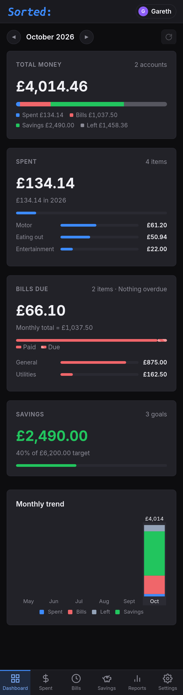
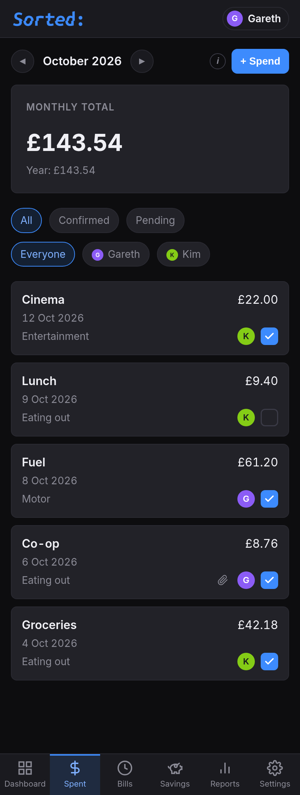
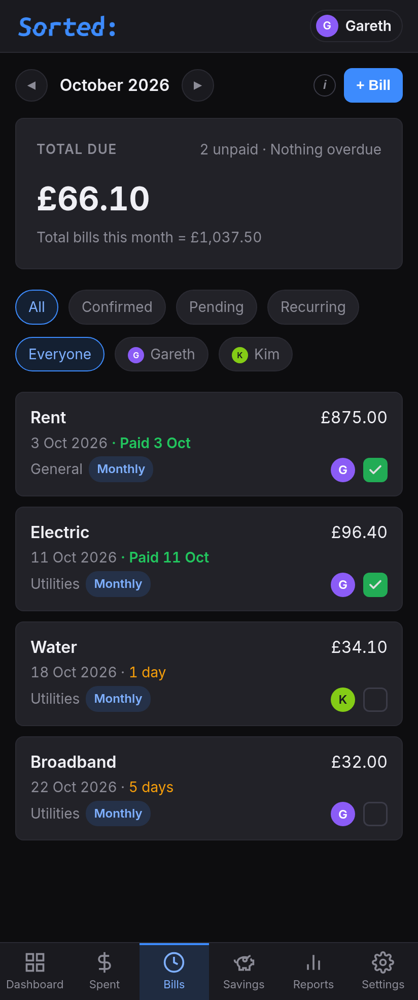
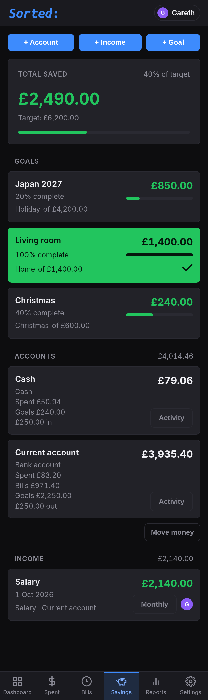
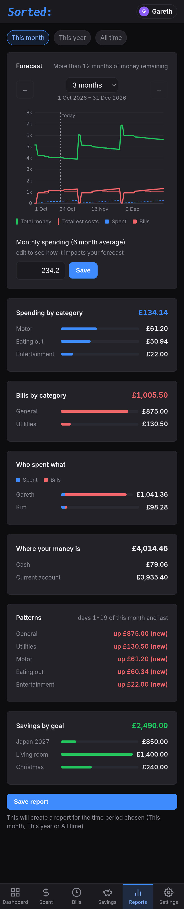
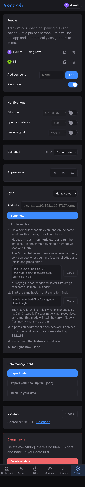

# Sorted

Easily check and track your spending, saving and bills, all local and private.

**Sorted v2** is a modern rewrite: a dark-themed finance tracker that runs as a desktop app (Electron) and straight in your browser. No backend, no cloud, no login — everything lives in your device's local storage (IndexedDB).

Try it live at [jaquesbody.github.io/sorted](https://jaquesbody.github.io/sorted/) — no install needed.

## Screenshots

All six are the same household on a 412px phone viewport: Gareth and Kim, a current account and some cash, three goals, and a month with some bills already paid and one spend left unticked.

| | |
|---|---|
|  |  |
|  |  |
|  |  |

## Features

- Dashboard: **Total money** — the balance at the end of the month you're looking at — with a bar and a legend saying what went to spend, bills and goals, and what's left after what's still owed. Alongside it, spent, bills due and savings for the same month, and a 6-month trend chart split into Spent, Bills, Left and Savings, each month drawn as the balance it ended on
- People: mark spend, bills and savings goals as somebody's, and see a coloured dot on each row. A chip in the top bar says who's using the app, so new entries and bill payments are marked automatically. This is attribution, not a login — anyone can switch, and there's still no account
- Give someone a PIN and entering it instead of the app passcode both unlocks the app and switches to them, so the right person is marked without touching anything. The app passcode keeps working exactly as before, and anyone who can reach Settings can reset a PIN without knowing it — it says who you are, not that you're allowed in
- A person filter on Spend and Bills — Everyone, or one person — sharing one selection across both. The Spend total follows it; the Bills total stays household-wide
- Marking a bill paid records who paid it, which can be someone other than the bill's owner
- Spent, Bills, and Savings lists — add, edit, and delete, and mark bills as paid
- **The tick beside a spend entry is what says the money has actually gone.** An unticked row is spending recorded but not yet made: it appears on the Spent tab, and counts towards nothing. Not the account balance, not Total money, not the Spent card, not a report, not the month's history. Ticking it is the event that moves the money, and un-ticking it puts it back. The Spent tab still lists unticked rows under Pending, because that's the one place a pending row must not be hidden — it's where you tick it
- A bill you tick is still a bill: it stays in the list with the date you paid it, its tick un-pays it, and it can still be edited. Deleting a repeating bill asks which you mean — this one, or this one and every month of it
- Every row reads as a small table: the amount on the right, its timing underneath, and the receipt paperclip, the person and the tick in one 24px row beneath that. The paperclip only appears when there's actually a picture
- Recurring: say whether something repeats monthly or annually. It rolls its due date forward by that much when paid, and projects its own next occurrences into the months ahead — twelve months for monthly, the same time next year for annual — so stepping forward shows what those months hold instead of an empty page. Projected rows are dashed, marked, and have no buttons: they're a forecast, not something to pay
- A month selector on Dashboard, Spend and Bills, all the same width; tap the month name to jump back to the current one
- Bills filters — All, Confirmed, Pending, Recurring — over the month's bills paid as well as unpaid, so a month you've already dealt with is still worth looking at
- Reports: spending, bills and savings goals broken down by category, over all time, this month or this year. Each card carries its total on the same line as its heading. **Save Report** at the bottom of the page writes all seven cards — for whichever period is selected above it — as a spreadsheet, a text listing or a PDF
- Patterns: which days you actually spend on, averaged over the last eight weeks, and whether this week is a normal one. Averages come from the weeks you recorded in, not from empty ones — otherwise a quiet fortnight reads as you spending half as much on every day
- Both are arithmetic on your own data. No network, no API key, no model, and nothing about your spending leaves the device — which is the whole reason they exist instead of a search API
- Three reminders, each off until you ask for it: bills coming due or already overdue, nothing recorded today, and a savings goal going untouched. On Android these are scheduled by the system, so they arrive whether or not Sorted is open — bills in the morning, the other two at a time you pick. In a browser there's no way to wake the app at a set hour, so the same checks run when you open it and put it away, and the settings say so rather than implying more
- Start Over: delete everything and start from empty, in Settings. A new install starts empty too — there's no sample data to delete. The first thing it shows instead is a card saying what the app does with your data, and then never again
- Sync, in Settings: keep a copy of everything on a machine that stays on, and take it with you when you change phone. The whole database goes as one file, and whichever device wrote it last is what the other one gets — so a bill you delete on one device stays deleted on the other, rather than coming back on the next sync. Before anything is replaced, the copy it replaced is kept, with a Restore button beside it. It also syncs on its own when the data changes, when you return to the app, and every 15 seconds while it is open; the button is for asking now and hearing what happened
- Setting it up is **one setting and one button**, over three routes. **Syncthing** takes a folder something else already keeps in step. **Cloud** takes one file in Google Drive, Proton Drive or OneDrive, saved or opened through Android's own file picker. **Network** takes two addresses for the same host: the Wi-Fi one the sync host prints, and a Tailscale one for when you are away from home, and it uses whichever answers first, so a Wi-Fi address that is not there does not hold up Tailscale. A folder route asks for a single **Choose folder** button; the file route asks for **Save new copy** on the first device and **Choose file** on the others. No storage permission is asked for and nothing is hard-coded, so it is the same steps on any phone and any drive
- Nobody has to work out what "Failed to fetch" means either. On the Network route, a sync that cannot reach the host asks the host itself and says which of the ways it failed; on the folder and file routes the message is the picker's own — *"That folder is no longer there. Choose it again."* The toasts follow the route too, so a folder route says **Folder set up** rather than claiming a server
- Underneath sits **the setup steps for whichever route is selected**, folded shut until you unfold them. They are written for someone who has never opened a terminal: nodejs.org and git-scm.com are links to the download pages, each command sits in its own box with a **Copy** button beside it, and one line under each command says the one thing that goes wrong with it — *If it says **git** is not recognised…*. Each route's list stands on its own, the Network one carrying both the Wi-Fi and the Tailscale address. The Syncthing and Cloud routes ask for no terminal at all. Chrome and Edge on a desktop offer those two as well, through the File System Access API: the page asks for a folder or a file and remembers the choice. Firefox and Safari cannot, so they are offered the Network route only rather than a button that would not work
- The folder or the file is the transport, and it is the whole of it: Sorted reads and writes one `sorted-snapshot.json` in the folder you chose, or in the one document you chose. Whatever keeps that in step — Syncthing, your drive app, a USB stick — carries it. Sorted has no server and no account in any of this; the file is in a drive you already have, reached through your own app. The permission is remembered across restarts, and choosing a different folder or file lets go of the last one, because Android holds only a handful of these per app
- To run the other end of an address route, on any machine with Node: clone the folder and run `node sorted/tools/sync-host.mjs --dir ~/sorted-sync` — pointed at the file rather than standing in the folder, so it does not matter where the terminal is. The script is at `tools/sync-host.mjs`; `--dir` is the folder the one synced file lives in, and left off it goes to `~/sorted-sync`, a home folder rather than the system's temp folder, which a reboot can empty. It serves that one file over your Wi-Fi and nothing else — no database, no accounts, no history — and prints one address for each network the machine is on, the Wi-Fi one beginning `192.168.` among them, for pasting into Settings
- The app and a browser can sync to each other, but only if both ends speak the same scheme: an **https** page cannot fetch an **http** address. The published site is https, so syncing from it to a host on your Wi-Fi needs the host to be https too. The least work is `tailscale serve --bg 8787` on the computer, which gives you an `https://` address on your tailnet proxied to the same host and the same file. Served locally over `http://localhost`, the browser app can talk to an http host as it is
- Export offers three formats rather than one, because they do three different jobs: a **`.csv`** of every dated movement for Excel, Numbers or Google Sheets, a readable **`.txt`** statement grouped by month, and a **`.pdf`** of the same rows typeset. The **`.json` backup** — the only one Import can read back — is its own **Back up your data** button on the Data Management card, because a backup is a different question from a format for reading. Everything is saved through Android's own save screen, where you pick the folder and the file name, and is an ordinary download in a browser. The PDF is written by the app itself: no print dialog, no library, and no network
- Reminders, each off until you ask for it, saying exactly this:
  - **"Sorted — bill due"** — *"Rent is due Thursday"* (or *"… is overdue"*)
  - **"Sorted — nothing recorded today"** — *"Anything you spent today? A minute now saves guessing later."*
  - **"Sorted — nothing going in"** — *"No goal has been topped up in 7 days."* (or your chosen cadence)
  - Bills are said once a day per bill, so a bill left unpaid does not nag all morning. Reminders are inexact by design: Sorted does not ask Android for permission to wake exactly on the minute, so they arrive *near* the time rather than on it
- Reminders you can check without waiting: two controls in Settings. **Show one now** posts a notification immediately, which proves Sorted is allowed to post at all. **Arm one** sets a real alarm five minutes out, which proves the phone accepted it — and that one is **inexact**, because Sorted deliberately does not hold Android's exact-alarm permission (a nudge about tonight's spending does not need to land on the minute, and the permission needs its own grant on Android 12+). So it arrives *near* five minutes rather than at it, and Sorted says so rather than promising a minute it cannot keep. Underneath both, the list is what the phone itself says is pending, read back from the system rather than from what Sorted believes it asked for — the two can disagree, and a switch showing "on" isn't proof anything will arrive
- Reminders are rebuilt from the database every time anything changes — a bill paid, a spend recorded, a goal topped up, anything deleted, everything wiped — rather than tracked one at a time, so what arrives always matches the data
- Switching tabs always opens at the top of the new tab rather than wherever you left the last one
- A "Who Spent What" report: one bar per person, its length their share of the household total, split blue for what they spent and red for what they owe. Money nobody is marked against is its own row, so the card adds up to the summary
- Month navigation and status filters
- Categories: Utilities, Motor, Entertainment, Shopping, General, Travel, One-Off — the same list for bills as for spend, and anything an entry is already filed under stays offered. Savings goals have their own: Holiday, Car, Christmas, One-Off, Other
- A savings goal you've reached turns the whole card green with the text in black and a tick beside it
- Bank accounts, and cash as an account rather than a separate payment method. The Savings page lists them above your goals, each with a balance and the spend, bills and goal amounts that moved it. Spending, paying a bill or putting money into a goal says which account it came from, and the balance follows on its own. There's no "not from an account" on those two forms: money that never left a tracked account cannot be deducted from one
- Move money between accounts when you transfer it for real, and adjust a balance by hand for anything the app can't infer (interest, fees, a correction)
- Reports gains a "Where Your Money Is" card and a Forecast chart
- Receipt capture: snap or upload a receipt (image or PDF) on the Spend or Bills form and the app pre-fills the title, amount and date for you to confirm
- Receipt reading is measured, not assumed. Four receipts with known answers — a total whose figure is printed on the line below, a VAT total sitting beneath a larger loyalty-points balance, a cash receipt where the tendered amount is the biggest number on the page, and one with no currency symbol anywhere — are drawn at three tilts and read through the real pipeline. Measured against that: **12/12 on amounts, 12/12 on titles, 12/12 on dates**, up from 10/12 and 9/12. Images are lifted before reading, because Tesseract wants text around 30px tall and a phone photo is often well under it: at 12px the decimal points disappear ("1.75" read as "175") and the date collapses
- The amount found is the amount *owed*, not the cash handed over: "subtotal" is ranked below "total", "cash", "change" and card lines are excluded, and a total whose figure is on the next line is picked up from there
- Receipts are kept with the entry — a paperclip on the row opens it full size, and the Edit popup can view, replace or remove it. PDFs are stored as a first-page image
- Light, dark, or follow-the-system theme, set in Settings and applied before the first paint — as is the phone layout itself, so the side rail never flashes on launch
- Change the currency in Settings: fifty-one of them. Your figures are stored as plain numbers, so changing the symbol never rewrites anything
- Check for updates in Settings: it asks GitHub for the newest release and compares versions numerically. Nothing is installed without you saying so — Android requires a human to confirm any install regardless
- Android asks for the notification permission on first use (Android 13+ requires it, and without it the channel is created silently and nothing ever appears). The schedule is **inexact** on purpose — an exact alarm needs its own grant, and Play only allows it to alarm-clock apps
- Optional passcode: a numeric keypad locks the app on launch and again after a set idle period (1, 5 or 30 minutes, or immediately when it's put away). Only a salted hash of the passcode is stored
- Export as CSV, plain text or PDF, plus a JSON backup; import reads the JSON backup and asks first: merge (existing kept, duplicates skipped) or replace everything (double-confirmed). Receipt images and your list of people travel with the backup
- Works in the browser, on the desktop as an Electron app, and on Android — where the six destinations sit in a bottom bar instead of a side rail

## Run It

### Desktop app (Electron)

    git clone https://github.com/jaquesbody/sorted.git
    cd sorted
    npm install
    npm start

### In a browser

Serve the `docs` folder with any static file server:

    git clone https://github.com/jaquesbody/sorted.git
    cd sorted
    python3 -m http.server --directory docs

Then open `http://localhost:8000` in your browser. Same app, minus the native export dialogs (export downloads a JSON file instead).

Served over HTTPS, Chrome will also offer to install it — there's a web manifest, so it gets its own window and its own icon instead of a bookmark. Installing is optional and there's still no service worker: nothing is cached, and the app behaves exactly the same either way.

### Tests

    npm test

720 functional checks, and none of them are unit tests: it drives the real UI in headless Chromium, adds accounts and bills and goals, and asserts on what appears. It needs a static server on `docs` (see above, on port 8141) and `chromedriver` on your PATH, and it exits non-zero if any check fails. The suite lives in `tools/harness/` — including the README of traps it has caught, which is the more useful half.

### Android (APK)

Grab [`sorted-v2-2.103.0-debug.apk`](https://github.com/jaquesbody/sorted/releases/download/v2.103.0/sorted-v2-2.103.0-debug.apk) from the [releases page](https://github.com/jaquesbody/sorted/releases/latest) and sideload it (your phone will ask to allow installs from unknown sources). It's the same app wrapped in a WebView — fully offline, data stored on the phone. The phone build moves the six destinations into a bottom bar; append `?native` to the web URL to preview that layout in a desktop browser.

APKs are build artefacts, so they live in releases rather than in this repo — every past build is still on the releases page.

### Updating an installed copy

Sideloading a new APK over the old one **keeps your data** — Android replaces the app but leaves its storage, which is where the app's IndexedDB lives. Just install the newer file over the older one; don't uninstall first, because uninstalling is what deletes the data.

Exported before upgrading is the belt to that braces: the export is a JSON file you can import again if a build turns out to be broken.

To rebuild it yourself (needs JDK 21 and the Android SDK):

    npm install
    npm run sync:android
    cd android
    ./gradlew assembleDebug

`npm run sync:android` is `cap sync` with the staged bundle wiped first. Capacitor
copies `docs/` into `android/app/src/main/assets/public/` but never removes what is no
longer there, so a plain `npx cap sync android` grows the APK with every file the web
build has ever had — a deleted screenshot stays in the bundle for good.

The signing key is committed at `android/debug.keystore` and pinned in `build.gradle`, so any machine can build an APK that installs as an update over an existing one. Android rejects an update signed with a different key, so if you ever change that file the next install will be refused and the only fix would be an uninstall — which deletes the data. Its fingerprint is recorded in `build.gradle`; if a build ever starts failing to install, check that the APK's certificate still matches the keystore's.

Note: importing JSON works on every platform and accepts only a Sorted backup — a CSV cannot be read back, and guessing at arbitrary column layouts is how an import quietly corrupts a dataset. Export offers the three formats and uses the native save dialog on desktop and on Android, and downloads a file in the browser.

## Tech Stack

- Vanilla HTML, CSS, and JavaScript — no frameworks
- Electron for the desktop shell
- IndexedDB for local storage, plus `localStorage` for the theme and passcode
- Zero runtime dependencies in the web app (OCR and PDF libraries are vendored in the repo)
- `@capacitor/local-notifications`, for scheduled reminders on Android. It's the only plugin the app uses, and it needs no server
- Tesseract and pdf.js are loaded on demand, when a receipt is actually picked, rather than on every page load — they are two thirds of the payload and a screen doesn't need either

## Privacy

No backend, no login, no server of ours anywhere. Your data stays on your own device and only leaves it when you export it or sync it yourself — to a folder, a drive or a machine you chose.

The first thing a new install shows is a card said in so many words — your spending and saving are tracked privately, everything stays on the device, nothing leaves without your say-so, and the code that backs the claim is a link away. It appears once and is remembered after that. It is deliberately not a modal with an Accept button, because a notice you have to agree to is a notice you can be held to; this one just tells you and gets out of the way.

Accounts, income and their transfers are part of that: balances are worked out on your device from your own entries and never sent anywhere.

Reminders are local too, and can only be as private as the thing they mention: a bill notification carries its title and amount, and the spending nudge says whether today is empty. Anyone holding the phone can read that from the lock screen — the same exposure the app's own lock screen already has. There's no server that could see any of it, and no reminder can be turned into anything that reaches anyone else. The Forecast card projects your balance **day by day** over a window you choose — 1, 3, 6 or 12 months — from your balances, your income's dates, your bills' dates and an average of your other spending. Step it back a month and it shows days you actually recorded rather than a projection. It tells you the lowest point your balance reaches and when, which is usually just before payday.

People are labels, not accounts: a person is a name and a colour, and anyone can switch who they're being. That makes attribution useful on a shared device and useless against anyone determined — it is not access control.

The passcode is a privacy screen, not encryption: it stops the app being readable when you hand your phone over, and it can't protect data from anyone who already has the unlocked device. It isn't backed up, so a forgotten passcode means clearing the app's storage to get back in.

A person's PIN works the same way, with one extra thing to be clear about. It identifies who is using the app — it does not authenticate them. Anyone who gets into the app can reset anyone's PIN from Settings without knowing the old one, and can still switch the top-bar chip afterwards. It saves a shared device from attributing your shopping to the wrong person; it is not a way of keeping anyone out, and a four-digit family PIN is not something to rely on. Person PINs aren't backed up either.

## History

v1 — the original web/PWA with service worker and Syncthing sync — lives in the git history; check out any commit from before the v2 rebuild to run it.

## Licence

MIT — see [LICENSE](LICENSE).
